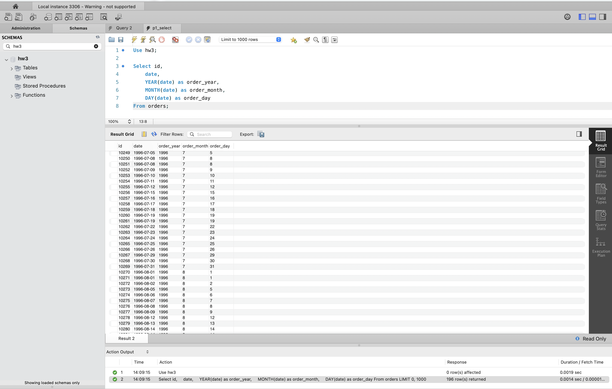
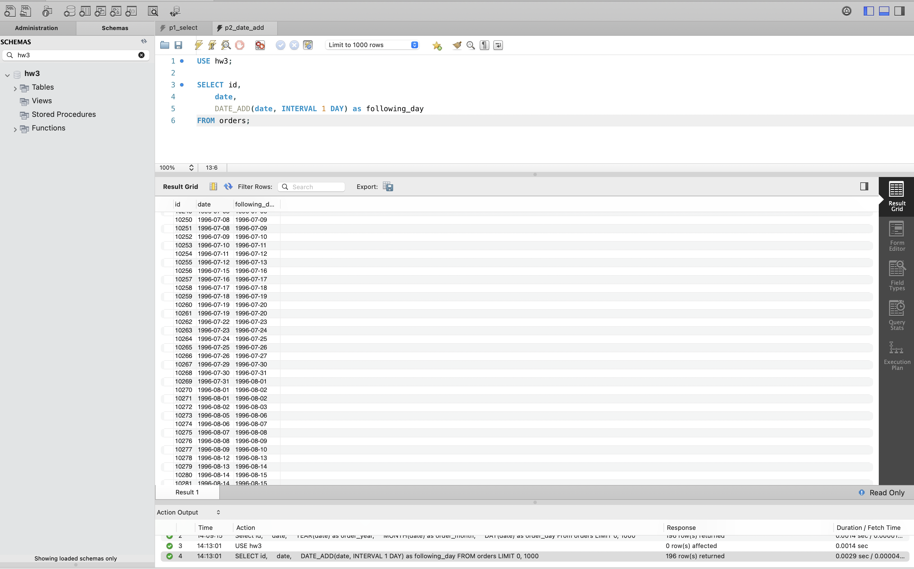
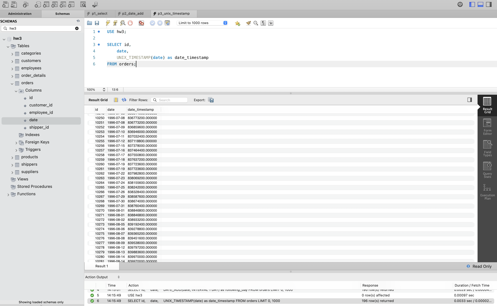
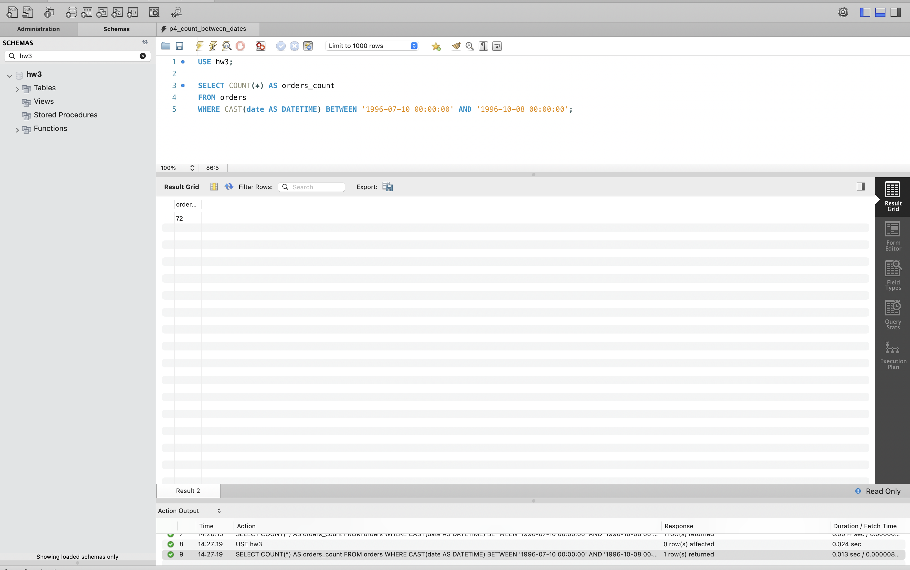
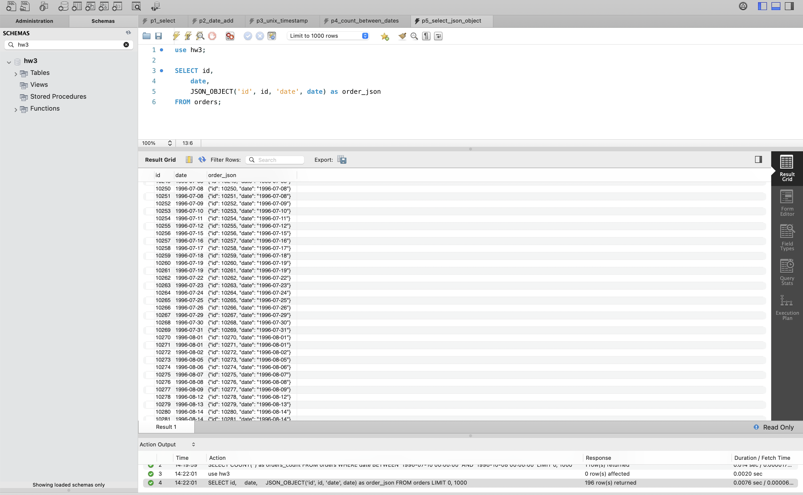

# goit-rdb-hw-07

## ДЗ з РБД. Додаткові вбудовані SQL функції. Робота з часом. JSON

## №1. [Запит, який для таблиці orders з атрибута date витягує рік, місяць і число](sql/p1_select.sql)

## №2. [Запит, який для таблиці orders до атрибута date додає один день](sql/p2_date_add.sql)

## №3. [Запит, який для таблиці orders для атрибута date відображає кількість секунд з початку відліку](sql/p3_unix_timestamp.sql)

## №4. [Запит, який рахує, скільки таблиця orders містить рядків з атрибутом date у межах певних дат](sql/p4_count_between_dates.sql)

## №5. [Запит, який для таблиці orders виводить на екран атрибут id, атрибут date та JSON-об’єкт](sql/p5_select_json_object.sql)

